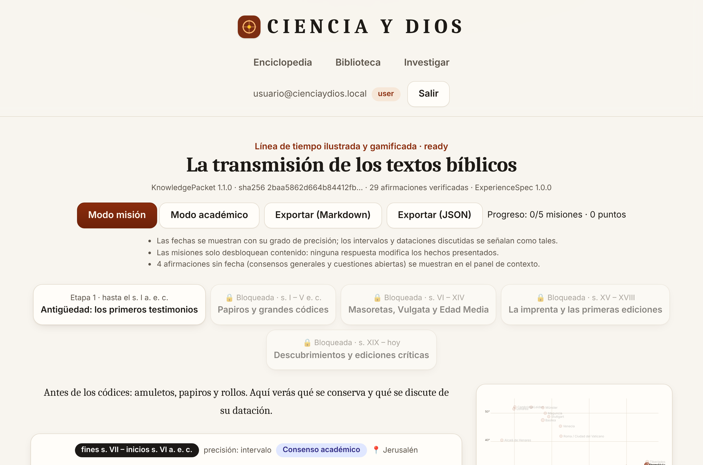

# CIENCIA Y DIOS

**Enciclopedia universal inteligente**: investiga, contrasta, documenta, enseña y transforma el conocimiento en
experiencias interactivas, sin sacrificar el rigor científico, histórico, filosófico o documental.

> **Principio central: la evidencia antes que la conclusión.**
> Investigar para comprender, no para justificar una conclusión previamente determinada.

| Núcleo | Motor documental | Motor de presentación |
|---|---|---|
| **HARNESS SUPRA**: orquestación multiagente con estados, DAG en LangGraph, checkpoints, presupuesto y auditoría | **EVIDENCE ENGINE**: afirmaciones ↔ evidencias literales ↔ fuentes ↔ perspectivas, con 10 categorías epistémicas | **EXPERIENCE OS**: KnowledgePacket → ExperienceSpec → Renderer |

Proyecto **independiente de ChatBiblia**: tiene su propio repositorio, base de datos, autenticación, frontend,
backend, agentes, configuración y despliegue.



## Estado (fase 1, MVP)

- ✅ **Prueba final obligatoria superada en un navegador real**: 16/16 comprobaciones (`apps/web/e2e/final-test.mjs`).
- ✅ **69 pruebas de backend** sobre PostgreSQL 16 + pgvector real (RLS, HARNESS, API, contratos, conectores); 90 % de cobertura.
- ✅ 9 de los 40 agentes operativos (los demás están registrados con su contrato y nunca se asignan).
- ✅ 22 de las 76 tablas diseñadas, todas con RLS.
- ⚠️ Pendiente con honestidad (ver [`docs/PHASE-1-REPORT.md`](docs/PHASE-1-REPORT.md)):
  - el proyecto Supabase real no se ha creado;
  - los conectores externos solo se han probado con respuestas simuladas;
  - todavía no hay proveedor LLM;
  - el corpus semilla está pendiente de revisión experta.

## Inicio rápido

Requisitos: Docker Desktop, Python 3.11+ y Node 22. Pasos detallados para Windows y macOS/Linux en
[`docs/RUNBOOK.md`](docs/RUNBOOK.md#desarrollo-local-sin-supabase).

```bash
docker compose up -d db                                   # PostgreSQL 16 + pgvector
cd apps/api && python3 -m venv .venv && .venv/bin/pip install -e ".[dev]" && cp ../../.env.example .env
.venv/bin/python -m cdd.dbreset && .venv/bin/python -m cdd.seed --dev-users
.venv/bin/uvicorn cdd.main:app --port 8000                # API + worker
cd apps/web && npm ci && cp .env.example .env.local && npm run dev   # otra terminal
```

Abre http://localhost:3000 → **Entrar** → «Usuario» → **Investigar** (la consulta de la prueba final viene precargada).

## Documentación

- [Arquitectura](docs/ARCHITECTURE.md)
- [Modelo de datos (76 tablas, RLS)](docs/DATA-MODEL.md)
- [40 agentes](docs/AGENTS.md)
- [Seguridad](docs/SECURITY.md)
- [Runbook (local, Vercel, worker)](docs/RUNBOOK.md)
- [Conectar a Supabase paso a paso](docs/SUPABASE.md)
- [Gemini, búsqueda en 3 dimensiones y HARNESS de bibliografía](docs/GEMINI.md)
- [Publicar en internet (Render + Vercel)](docs/DEPLOY.md)
- [API de las tablas de Supabase (generada)](docs/API-TABLAS.md)
- [Informe de la fase 1](docs/PHASE-1-REPORT.md)
- [Hoja de ruta](docs/ROADMAP.md)
- Contratos versionados y tipos de la base: [`packages/contracts/`](packages/contracts)

## Estructura

```
apps/api        FastAPI · HARNESS · Evidence Engine · Experience Compiler · worker
apps/web        Next.js 16 · React 19 · TypeScript estricto · Tailwind 4 · PWA
supabase/       migraciones SQL (esquema, RLS, búsqueda híbrida, hooks de auth)
corpus/         corpus semilla verificado (transmisión de los textos bíblicos)
packages/       contratos JSON Schema (KnowledgePacket 1.0.0, ExperienceSpec 1.0.0)
docs/           documentación y capturas
```
